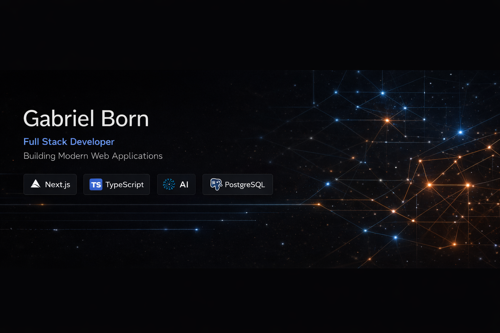

Sou o Gabriel, estudante de Análise e Desenvolvimento de Sistemas no UniSenai, em Florianópolis. Antes disso fiz o técnico em Desenvolvimento de Sistemas integrado ao ensino médio, no SESI/SENAI.

Trabalho principalmente com Next.js, TypeScript e Postgres. Hoje passo a maior parte do tempo em projetos com 3D no navegador, simulação e IA dentro da interface.

## Projetos

| Projeto | O que é | Stack |
|:--|:--|:--|
| **[Simulador RBMK](https://simulador-rbmk.vercel.app/)** | Simulador educacional do reator de Chernobyl: painel de controle, cenários de 1986, salão do reator em 3D e um conselheiro com IA. | Next.js, TypeScript, Web Workers, React Three Fiber |
| **casa-3d [Manutenção]** | Visualização 3D de uma casa a partir da planta em DWG, com raio-x das paredes e camadas por pavimento. | Next.js, React Three Fiber, Python |
| **[Ordex](https://ordex-repo-v1.vercel.app)** | Site de um serviço de landing pages por assinatura, com painel administrativo e portal do cliente. | Next.js, Supabase, Prisma |
| **[Veritas](https://veritas3.vercel.app)** | Sistema para escritório de advocacia, front e back. O projeto mais completo que fiz no curso. | Next.js, Prisma, PostgreSQL |
| **[local-face-privacy](https://github.com/Gabrielb0rn/local-face-privacy)** | Detecta e censura rostos da webcam em tempo real, sem nada sair do PC. Funciona no OBS, Discord e Zoom. | Python, OpenCV |

Projetos mais antigos do curso

 

- [EasyDesk.io](https://github.com/Gabrielb0rn/EasyDesk.io): sistema de gestão de empresa.
- EcoSmart: gestão de energia com Arduinos, aplicativo e site.
- [Portfólio 1T 2025](https://v0-site-o3.vercel.app): trabalhos e atividades do primeiro trimestre de 2025.

## Stack

**Linguagens** &nbsp;

**Web** &nbsp;

**Dados** &nbsp;

**Ferramentas** &nbsp;

**Estudando agora:** arquitetura de sistemas, LLMs dentro de aplicações (RAG, agentes), Docker e segurança de aplicações web.

## No GitHub

  <picture>
    <source media="(prefers-color-scheme: dark)" srcset="https://streak-stats.demolab.com/?user=Gabrielb0rn&theme=dark&hide_border=true&background=00000000" />
    
  </picture>
    
  <picture>
    <source media="(prefers-color-scheme: dark)" srcset="https://raw.githubusercontent.com/Gabrielb0rn/Gabrielb0rn/output/github-contribution-grid-snake-dark.svg" />
    
  </picture>

## Fora do código

- Fui escoteiro por 10 anos.
- Faixa ponta-azul, depois de 6 anos de treino.
- Treino táticas de CQB com réplicas e leio bastante sobre estratégia militar.

## Contato

[gabrielborn1111@gmail.com](mailto:gabrielborn1111@gmail.com) · [LinkedIn](https://www.linkedin.com/in/gabriel-oliveira-born-88019b292/) · [Portfólio](https://gabrielborn.vercel.app/)
